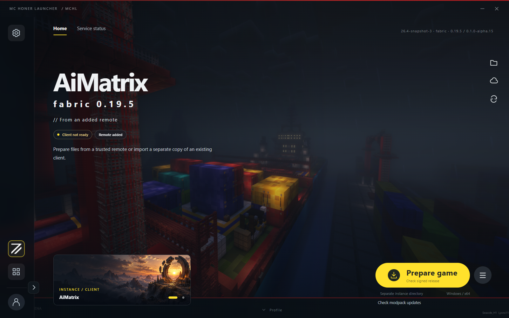
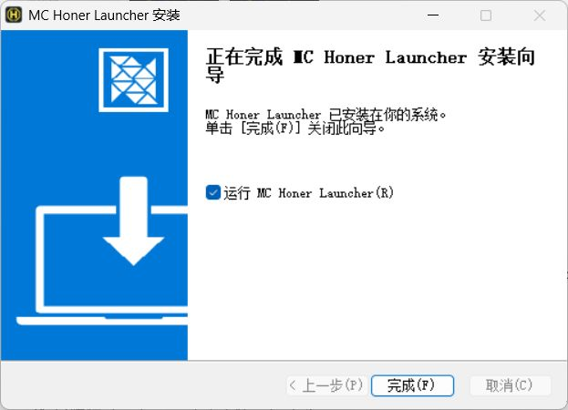

> NOT AN OFFICIAL MINECRAFT PRODUCT. NOT APPROVED BY OR ASSOCIATED WITH MOJANG OR MICROSOFT.

# MC Honer Launcher (MCHL)

English · [中文](README.md)

MC Honer Launcher is a Minecraft: Java Edition launcher under development for Windows. It manages game accounts, separate game instances and modpack updates. The client supports Simplified Chinese and English. Switch under Settings → Appearance → Interface language; the choice is saved immediately.

The GitHub repository owner, [SeasideH1](https://github.com/SeasideH1), is the individual developer responsible for this product. Contact: [qq1602770686@outlook.com](mailto:qq1602770686@outlook.com). This repository contains project information and interface images only. Source code and application packages are not published here.

## Sign-in, distribution and server access

Account sign-in verifies a player's legitimate Minecraft identity and entitlement to the game. Players authorize access through Microsoft's official sign-in page. The client retrieves the Minecraft player profile, and the main service verifies the identity before creating a platform account without a separate password. The authentication flow is implemented, but the application has not been approved for Minecraft Services access. The complete live sign-in and server admission flow remains unverified.

MCHL does not redistribute Minecraft. Modpack distribution contains only custom content, including mods, resource packs, shader packs and configuration files. It excludes vanilla Minecraft code, binaries and resource assets. Third-party content requires permission for redistribution. The client obtains the game and vanilla resources separately from official or authorized sources. Using the launcher or downloading a modpack does not grant a Minecraft licence.

The project contains no commercial paid content. Its operating rules allow players with a legitimate game entitlement to download the corresponding modpacks and join servers. Server operators may select a subset of players for testing. Test access must not involve commercial activity: it cannot be sold or tied to payments, donations, memberships, or purchases of other goods or services. Test players must also hold a legitimate game entitlement.

The client allows local offline identities only for offline launch modes explicitly permitted by a trusted remote's signed policy. These identities can use the permitted single-player or OPL modes, but cannot sign in to the platform or obtain authenticated server admission. Single-player launches supply no server address. OPL requires a running engine and connects only through enabled local OPL tunnels. An offline identity does not grant a game licence or downgrade a Microsoft account to offline authentication.

## Features and interface

Each game instance keeps its own version, account selection and launch settings. The client supports creating and importing instances, managing Java runtimes, downloading game files and launching the game. Modpack updates verify files against signed manifests, handle local configuration conflicts and support recovery after an interrupted update. World saves still need separate backups.

The main service manages platform accounts, friends, invitations and access grants. A separate distribution service publishes modpacks and serves downloads. Game servers report playtime; the development build keeps local guest timers separately.

*AiMatrix download section in the actual Windows `0.1.0-alpha.15` client, showing the game preparation entry point.*

*Windows installation completion screen in Chinese. The installer also supports English.*

## Development status

The client uses Electron and Node.js, with SQLite for local data. The main service uses PostgreSQL. The launcher runs separately from the game server; the statistics and admission adapter is installed only on the server.

The current development candidate is `0.1.0-alpha.15`. See the [development notes](docs/development.en.md) for the versions, environments and scope of recorded tests. These records do not establish release readiness. See [NOTICE.md](NOTICE.md) for software provenance, artwork and third-party licences.
