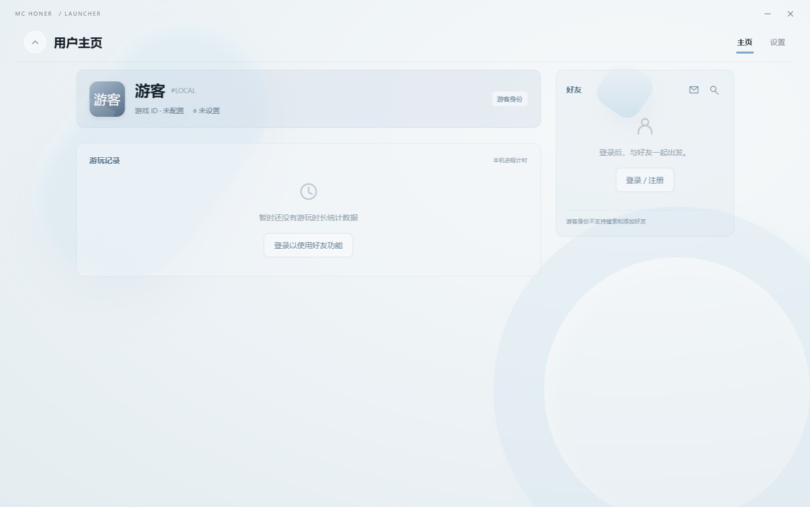

# MC Honer

English · [中文](README.md)

MC Honer is a Minecraft: Java Edition launcher under development for Windows. It manages accounts, game instances and modpack updates in one client, reducing the repeated setup, downloads and version management involved in switching between modpacks.

The current version is `0.1.0-alpha.1`. This repository contains project information and images. Source code and application packages are not yet published.

*Announcement background used by the launcher.*

## Features

Each game instance keeps its own version, account selection and launch settings. The client supports creating and importing instances, managing Java runtimes, downloading game files and launching the game. Modpack updates verify files against signed manifests, handle conflicts with local configuration changes and support recovery after an interrupted update. World saves still need separate backups.

Microsoft sign-in uses device authorization through the system browser. The client implements the Microsoft, Xbox Live and Minecraft Services authentication flow to obtain a game identity and retrieve entitlement information and player profiles. The project's application approval is pending; live authorization still needs to be tested after approval.

The project also includes a main service and a self-hostable modpack distribution service. The main service manages platform accounts, friends, invitations and access grants; the distribution service publishes releases and limits download traffic. Platform accounts are created from verified Minecraft identities without a separate password. Game servers report playtime, while local guest timers are stored separately.

## Interface

*Windows development build showing a local guest profile.*

## Development status

The client uses Electron and Node.js, with SQLite for local data. The main service uses PostgreSQL. The launcher runs separately from the game server; the statistics and admission adapter is installed only on the server.

Development tests on October 13, 2026 covered the Windows client, portable package, signed updates through a local distribution service and PostgreSQL service operation. In an isolated environment running Minecraft `26.4 Snapshot 3`, Fabric `0.19.5` and Java `25.0.1`, an offline account reached the game menu and exited normally. OPL was tested with two nodes on one machine; cross-network connections remain untested.

Authenticated sign-in and server admission, complete player-session statistics, public deployment and capacity testing are still pending. The candidate application has no Windows code signature. Launcher self-updates, executable plugin extensions and Linux / macOS builds are not yet available. See the [development notes](docs/development.en.md) for dependencies, configuration and test limitations.

MC Honer is an independent third-party project, not affiliated with or endorsed by Microsoft or Mojang. See [NOTICE.md](NOTICE.md) for software and image provenance, third-party licences and distribution information.
