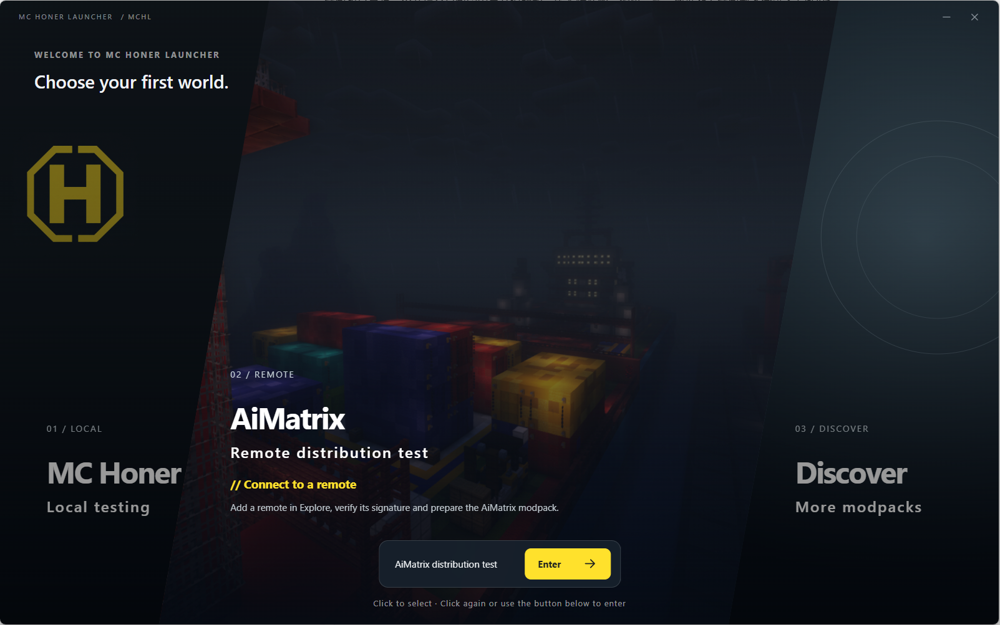
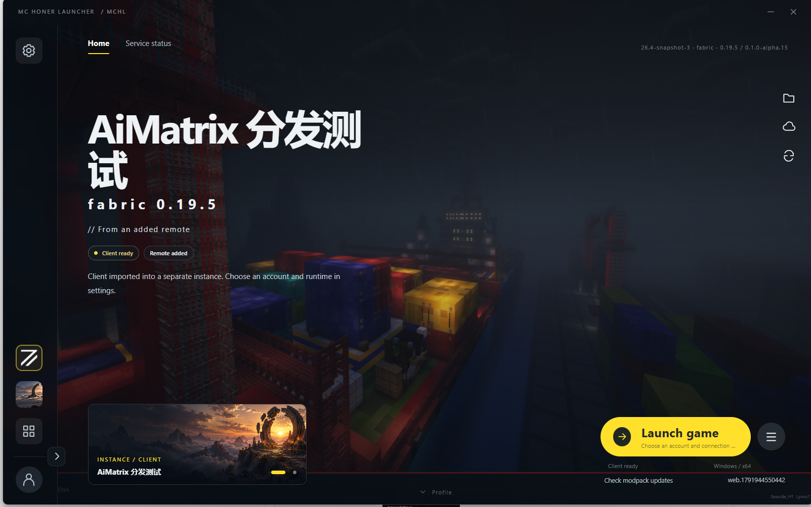
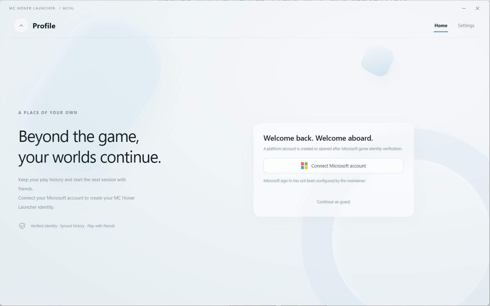
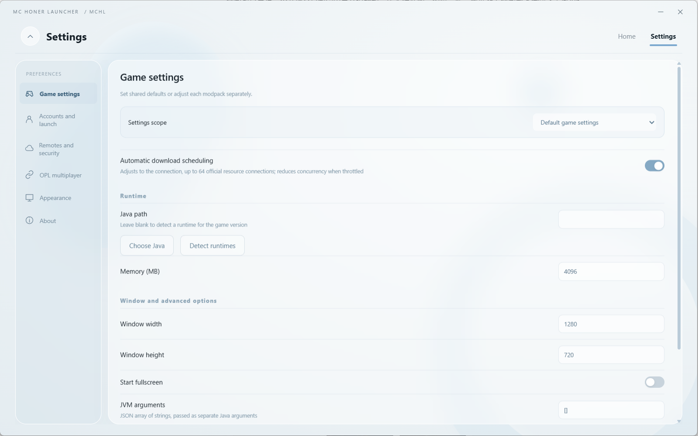

> NOT AN OFFICIAL MINECRAFT PRODUCT. NOT APPROVED BY OR ASSOCIATED WITH MOJANG OR MICROSOFT.

# MC Honer Launcher (MCHL)

English · [中文](README.md)

MC Honer Launcher is a Minecraft: Java Edition launcher under development, targeting Windows, macOS and Linux. It manages game accounts, separate game instances and modpack updates.
The client supports Simplified Chinese and English. Switch under Settings → Appearance → Interface language.

The GitHub repository owner, [SeasideH1](https://github.com/SeasideH1), is the individual developer responsible for this product.
Contact: [qq1602770686@outlook.com](mailto:qq1602770686@outlook.com).
The launcher is still in early development and testing. This repository contains project information and interface images only; source code and application packages are not published here.

## Sign-in, distribution and server access (provisional during early development and subject to minor changes)

Account sign-in verifies a player's legitimate Minecraft identity and entitlement to the game. Players authorize access through Microsoft's official sign-in page. The client retrieves the Minecraft player profile, and the main service verifies the identity before creating a platform account without a separate password.
The authentication flow is implemented, but the application has not been approved for Minecraft Services access. The complete live sign-in and server admission flow remains unverified.

MCHL does not redistribute Minecraft. Modpack distribution contains only custom content, including mods, resource packs, shader packs and configuration files. It excludes vanilla Minecraft code, binaries and resource assets. The client obtains the game and vanilla resources separately from official or authorized sources.

The project contains no commercial paid content. Its operating rules allow players with a legitimate game entitlement to download the corresponding modpacks and join servers. Third-party remote servers connected to the platform may select a subset of players according to their testing plans. Test access must not involve commercial activity: it cannot be sold or tied to payments, donations, memberships, or purchases of other goods or services. Test players must also hold a legitimate game entitlement.

The client allows local offline identities, but they can only be used when a trusted remote's signed policy explicitly permits offline play. These identities can launch only the single-player or OPL modes permitted by that remote; they cannot sign in to the platform or obtain authenticated server admission.

## Features and interface

Each game instance keeps its own version, account selection and launch settings. The client supports creating and importing instances, managing Java runtimes, downloading game files and launching the game.
Modpack updates connect to the remote update server defined by the launcher platform server to update the game client automatically.

The main service manages platform accounts, friends, invitations and access grants. A separate distribution service publishes modpacks and serves downloads.

## Development status

The client uses Electron and Node.js, with SQLite for local data. The main service uses PostgreSQL.
The launcher runs separately from the game server.

The current development candidate is `0.1.0-alpha.15`. See the [development notes](docs/development.en.md) for the versions, environments and scope of recorded tests. These records do not establish release readiness. See [NOTICE.md](NOTICE.md) for software provenance, artwork and third-party licences.
