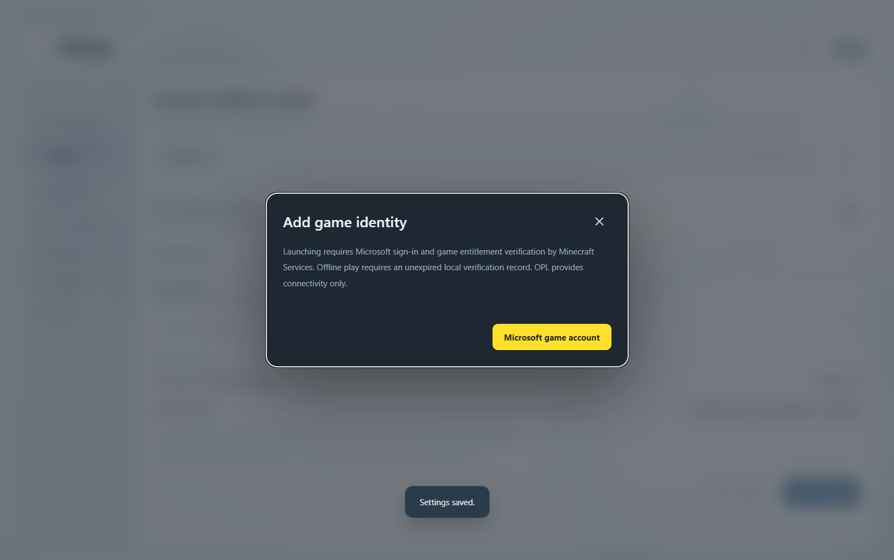
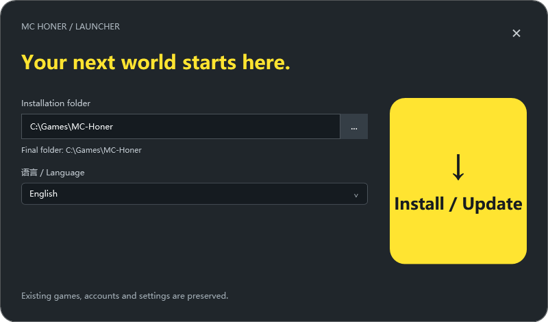

> 本项目不是 Minecraft 官方产品，未经 Mojang 或 Microsoft 批准，也不与其存在关联。

# MC Honer Launcher（MCHL）

[English](README.en.md) · 中文

MC Honer Launcher 是正在开发的 Minecraft: Java Edition 启动器，面向 Windows、MacOS、Linux，用于管理游戏账号、独立实例和整合包更新。
客户端支持简体中文和 English，可在“设置 → 界面与动效 → 界面语言”中切换。

本项目由 GitHub 仓库拥有者 [SeasideH1](https://github.com/SeasideH1) 作为个人开发者开发并负责。
联系方式：[qq1602770686@outlook.com](mailto:qq1602770686@outlook.com)。
启动器仍在早期开发测试中。[GitHub Release](https://github.com/SeasideH1/MC-Honer-Launcher/releases/tag/v0.1.0-alpha.28) 提供 Windows x64 预发行安装包；源码暂不公开。macOS 和 Linux 仍是开发目标，本次未提供安装包。

## 登录、分发与服务器访问

账号登录用于验证玩家的 Minecraft 正版身份和游戏访问资格。用户通过 Microsoft 官方页面授权，客户端取得 Minecraft 玩家资料，主服务核验身份后建立平台账号，无需另设平台密码。
目前认证流程已有实现，但应用尚未获准访问 Minecraft Services，完整的真实登录与进服流程仍待验证。

MCHL 不二次分发 Minecraft 游戏。整合包分发仅包含自定义内容，包括模组、材质包、光影包及 config 配置等，不包含 Minecraft 原版代码、程序或资源资产。游戏本体与原版资源由客户端从官方或获授权的来源单独获取。

项目不包含任何商业付费内容。运营规则允许拥有正版游戏资格的玩家下载对应整合包并进入服务器；平台所连接的第三方远程服务器可根据测试安排选择部分玩家参与测试。测试资格不涉及任何商业行为，不出售，也不得与付费、捐赠、会员或购买其他商品和服务挂钩。测试玩家同样需要正版游戏资格。

从 alpha.28 起，游戏启动必须使用已经 Minecraft 官方服务核验的 Microsoft 账号。已验证账号可在核验记录有效期内断网启动；有效期不超过 Minecraft 令牌到期时间，最长 24 小时，断网使用不会续期。缺少资格、核验记录过期或官方明确拒绝时阻止启动。旧离线和第三方账号记录保留，但不能用于启动。

OPL 仅负责连接，不能提供或替代游戏资格。远程运营者的测试许可同样不能绕过正版验证；服务器仍需独立验证玩家身份。具体检查及限制见[验证说明](docs/AUTHENTICATION-ALPHA28.zh-CN.md)。

## 安装与使用

1. 从 [alpha.28 发布页](https://github.com/SeasideH1/MC-Honer-Launcher/releases/tag/v0.1.0-alpha.28) 下载 Windows x64 的 `MC-Honer-0.1.0-alpha.28-x64-Setup.exe`。这是未签名的开发预发行包。
2. 运行安装向导，选择专用安装目录和界面语言。打开客户端后，可在设置中切换语言、管理实例及账号。
3. 当前包尚未配置获批准的 Microsoft AppID，因此新安装不能完成登录或启动游戏。待维护者配置本应用获批准的 AppID 后，玩家才能通过 Microsoft 页面授权，完成正版核验，再为实例选择账号并启动。

已有有效核验记录且游戏文件、Java 已准备好的用户，可在“设置 → 账号与启动 → 默认游戏设置”启用“使用已验证账号断网启动”并保存。恢复联网后关闭该选项。私有整合包或服务器准入可能仍需要网络。

以下界面图保留此前开发版本的外观记录；alpha.28 的账号规则以本页及验证说明为准。

## 功能与界面

每个游戏实例保存各自的版本、账号选择和启动设置。客户端支持创建、导入实例，管理 Java 运行时，下载游戏文件并启动游戏。
整合包更新会与启动器平台服务器定义的远程更新服务器连接，实现便捷的客户端自动更新功能。

主服务管理平台账号、好友、邀请和访问资格，独立的分发服务负责整合包发布与下载。

## 开发状态

客户端使用 Electron 和 Node.js，本地数据存储于 SQLite；主服务使用 PostgreSQL。
启动器与游戏服务端分别运行。

当前公开预发行版本为 `0.1.0-alpha.28`。已有开发测试的版本、环境与范围见[开发说明](docs/development.zh-CN.md)，这些记录不代表完整发行验收。软件来源、素材和第三方许可见 [NOTICE.md](NOTICE.md)。
