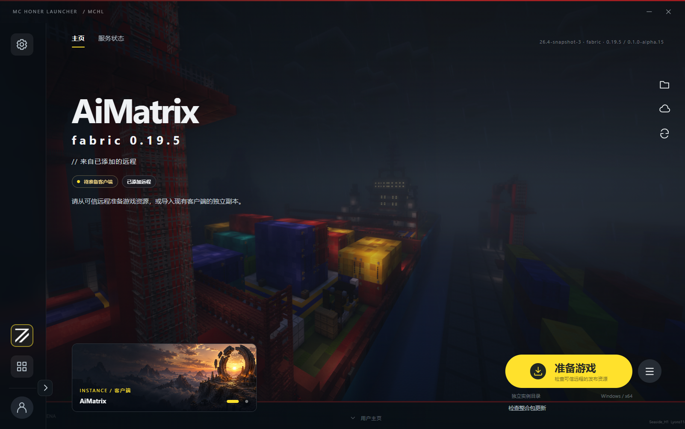

> 本项目不是 Minecraft 官方产品，未经 Mojang 或 Microsoft 批准，也不与其存在关联。

# MC Honer Launcher（MCHL）

[English](README.en.md) · 中文

MC Honer Launcher 是正在开发的 Minecraft: Java Edition 启动器，面向 Windows，用于管理游戏账号、独立实例和整合包更新。客户端支持简体中文和 English，可在“设置 → 界面与动效 → 界面语言”中切换，选择即时保存。

本项目由 GitHub 仓库拥有者 [SeasideH1](https://github.com/SeasideH1) 作为个人开发者开发并负责。联系方式：[qq1602770686@outlook.com](mailto:qq1602770686@outlook.com)。本仓库仅公开介绍和界面图片，暂不发布源码或程序包。

## 登录、分发与服务器访问

账号登录用于验证玩家的 Minecraft 正版身份和游戏访问资格。用户通过 Microsoft 官方页面授权，客户端取得 Minecraft 玩家资料，主服务核验身份后建立平台账号，无需另设平台密码。目前认证流程已有实现，但应用尚未获准访问 Minecraft Services，完整的真实登录与进服流程仍待验证。

MCHL 不二次分发 Minecraft 游戏。整合包分发仅包含自定义内容，包括模组、材质包、光影包及 config 配置等，不包含 Minecraft 原版代码、程序或资源资产。第三方内容必须取得分发许可；游戏本体与原版资源由客户端从官方或获授权的来源单独获取。使用启动器或下载整合包不授予 Minecraft 游戏许可。

项目不包含任何商业付费内容。运营规则允许拥有正版游戏资格的玩家下载对应整合包并进入服务器；服务器可根据测试安排选择部分玩家参与测试。测试资格不涉及任何商业行为，不出售，也不得与付费、捐赠、会员或购买其他商品和服务挂钩。测试玩家同样需要正版游戏资格。

客户端允许创建本机离线身份，但只有可信远程的签名策略明确开放离线方式时才能使用。离线身份仅可启动该远程允许的离线单机或 OPL 联机，不能用于平台登录或正版服务器准入。离线单机不传入服务器地址；OPL 联机要求引擎运行，连接目标限于已启用的本机 OPL 隧道。离线身份不授予游戏许可，也不会将微软账号降级为离线账号。

## 功能与界面

每个游戏实例保存各自的版本、账号选择和启动设置。客户端支持创建、导入实例，管理 Java 运行时，下载游戏文件并启动游戏。整合包更新按签名清单校验文件，处理本地配置冲突，并支持中断后的恢复。世界存档仍需单独备份。

主服务管理平台账号、好友、邀请和访问资格，独立的分发服务负责整合包发布与下载。游玩统计由游戏服务端上报；开发版的本机游客计时单独保存。

*AiMatrix 下载部分，Windows `0.1.0-alpha.15` 实际客户端截图，显示游戏资源准备入口。*

*Windows 安装完成界面；安装向导支持中文与英文。*

## 开发状态

客户端使用 Electron 和 Node.js，本地数据存储于 SQLite；主服务使用 PostgreSQL。启动器与游戏服务端分别运行，统计与准入适配器只安装在服务端。

当前开发候选为 `0.1.0-alpha.15`。已有开发测试的版本、环境与范围见[开发说明](docs/development.zh-CN.md)，这些记录不代表完整发行验收。软件来源、素材和第三方许可见 [NOTICE.md](NOTICE.md)。
